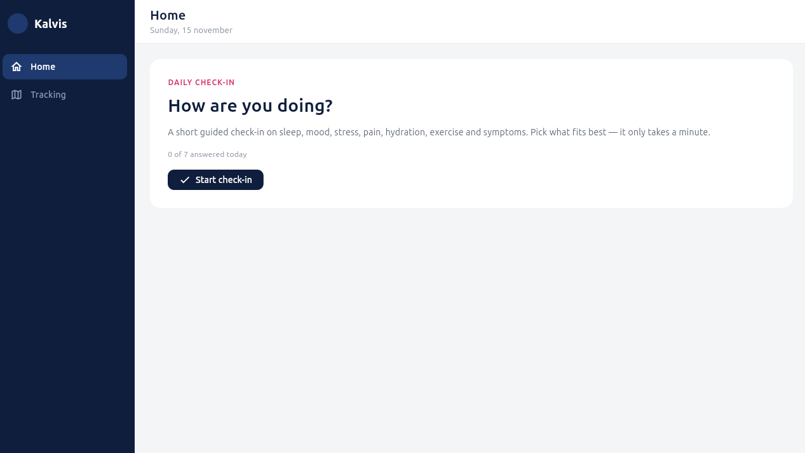
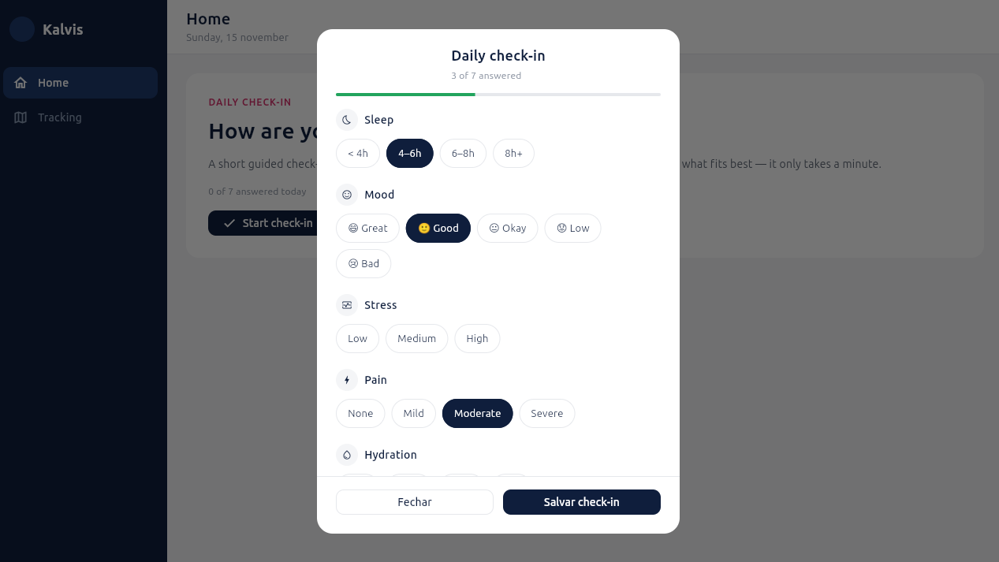
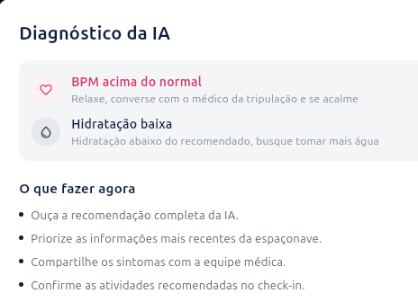
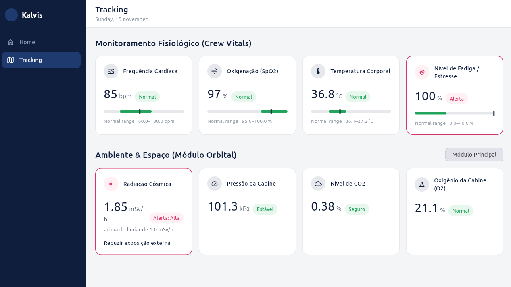

# Astronaut Health Monitoring & Decision Support System

**An offline-first health copilot for space missions, transforming physiological, behavioral, and environmental data into explainable assessments and contextualized guidance — even without a connection to Earth.**

<p align="center">
  
</p>

## About the Project

During space missions, astronauts face several factors that can affect their health, including physiological changes, sleep deprivation, stress, radiation exposure, environmental conditions, and changes in daily routines.

These factors should not be analyzed independently. A change in heart rate, for example, may have different meanings depending on an astronaut's individual history, sleep quality, physical activity, and environmental conditions.

This project proposes an offline-first health monitoring and decision-support system capable of correlating this information, identifying relevant changes, and providing explainable assessments and contextualized guidance.

Its architecture is designed to operate locally, without relying on a constant connection to Earth.

## The Problem

During long-duration space missions, communication with Earth may experience significant delays or connectivity limitations.

Astronauts therefore need access to relevant health information and decision-support capabilities directly onboard the spacecraft.

Additionally, analyzing isolated health indicators can hide important relationships between different factors.

The system addresses three main challenges:

- **Individual monitoring:** tracking physiological and behavioral changes based on each astronaut's personal baseline.
- **Contextual analysis:** correlating health indicators with environmental and operational conditions.
- **Autonomy onboard:** providing local assessments and guidance without depending on external services.

## Main Features

### 1. Health Dashboard

The home screen provides an overview of the astronaut's health status and relevant monitoring information.

<p align="center">
  
</p>

### 2. Physiological Monitoring

Monitoring of health indicators such as:

- Heart rate.
- Blood oxygen saturation (SpO₂).
- Respiratory rate.
- Heart rate variability (HRV).
- Body and skin temperature.
- Blood pressure.
- Glucose levels.

Measurements are organized chronologically to support the identification of changes and trends.

### 3. Behavioral Check-in

The system considers information related to the astronaut's daily routine and well-being.

<p align="center">
  
</p>

The check-in includes information such as:

- Sleep duration and quality.
- Fatigue.
- Stress.
- Mood.
- Hydration.
- Physical activity.
- Nutrition.
- Self-reported symptoms.

These records complement physiological measurements and provide additional context for individual health assessments.

### 4. Environmental Monitoring

The system also considers spacecraft environmental conditions:

- CO₂ concentration.
- Cabin temperature.
- Atmospheric pressure.
- Environmental radiation measurements.
- Astronaut location and time spent inside spacecraft modules.

By correlating astronaut presence with environmental measurements, the system can estimate accumulated exposure and investigate possible temporal associations with health changes.

### 5. Mathematical Analysis and Anomaly Detection

The analysis engine uses statistical methods and deterministic rules to identify relevant changes.

Analysis modules include:

- **Individual baseline:** establishing physiological references using the astronaut's historical measurements.
- **Variation analysis:** comparing current measurements against individual references.
- **Statistical analysis:** calculating mean, median, standard deviation, and other statistical measures.
- **Trend analysis:** identifying increasing or decreasing patterns over time.
- **Persistence analysis:** distinguishing isolated changes from recurring alterations.
- **Data quality assessment:** identifying invalid measurements, noise, temporal gaps, and insufficient samples.
- **Environmental exposure:** estimating accumulated exposure based on time spent in each spacecraft module.

The results are combined through deterministic business rules to produce contextualized health assessments.

Rather than relying exclusively on generic thresholds, the system considers individual baselines and the persistence of observed changes.

### 6. AI Health Copilot

The AI layer transforms technical assessment results into understandable explanations.

<p align="center">
  
</p>

Instead of simply displaying an alert, the system aims to explain:

- What was detected.
- Which indicators contributed to the assessment.
- How the measurements compare with the astronaut's individual baseline.
- Which environmental or behavioral factors may be associated.
- What guidance is relevant according to available medical references.

The AI acts as an interpretation and communication layer, not as a replacement for deterministic analysis or medical professionals.

Its responses are intended to be grounded in available data and medical references, avoiding unsupported diagnoses or recommendations.

### 7. Health Tracking

The tracking interface provides a visual overview of health measurements and their evolution over time.

<p align="center">
  
</p>

This helps astronauts understand changes in their indicators and follow their health history.

## Key Differentiators

The goal is not simply to monitor health indicators, but to transform different sources of information into meaningful decision support.

| Conventional Approach | Project Approach |
|---|---|
| Isolated vital sign monitoring | Integrated physiological, behavioral, and environmental analysis |
| Generic thresholds | Individual baselines based on historical measurements |
| Alerts without context | Explainable alerts with contributing indicators |
| Detection of isolated changes | Trend and persistence analysis |
| Dependence on connectivity | Local processing and storage |
| AI independently interpreting all data | Deterministic rules supported by an AI interpretation layer |

### Core Concept

**Monitoring + Context + Explainability + Autonomy.**

The system aims to answer not only whether an indicator has changed, but also how that change relates to the astronaut's individual baseline and surrounding conditions.

## Architecture

The architecture separates data collection, storage, mathematical calculations, business rules, and interpretation.

```text
┌──────────────────────────────────────┐
│            Flutter Frontend          │
│       Monitoring and Interaction     │
└───────────────────┬──────────────────┘
                    │
                    ▼
┌──────────────────────────────────────┐
│              Rust Backend            │
│                                      │
│  ┌────────────────────────────────┐  │
│  │          Sensor Adapter        │  │
│  │       Simulated Data           │  │
│  └───────────────┬────────────────┘  │
│                  ▼                   │
│  ┌────────────────────────────────┐  │
│  │        Monitoring Engine       │  │
│  │       5-second collection      │  │
│  └───────────────┬────────────────┘  │
│                  ▼                   │
│  ┌────────────────────────────────┐  │
│  │       Mathematical Analysis    │  │
│  │                                │  │
│  │ Baseline · Variation           │  │
│  │ Statistics · Trend             │  │
│  │ Persistence · Data Quality     │  │
│  │ Environmental Exposure         │  │
│  └───────────────┬────────────────┘  │
│                  ▼                   │
│  ┌────────────────────────────────┐  │
│  │       Business Rules            │  │
│  │       Health Assessment         │  │
│  └───────────────┬────────────────┘  │
│                  ▼                   │
│  ┌────────────────────────────────┐  │
│  │         AI Health Copilot      │  │
│  │     Contextualized Guidance    │  │
│  └────────────────────────────────┘  │
└───────────────────┬──────────────────┘
                    │
                    ▼
┌──────────────────────────────────────┐
│                SQLite                │
│          Local Data Storage          │
└──────────────────────────────────────┘
```

### Component Responsibilities

- **Flutter:** user interface and astronaut interaction.
- **Sensor Adapter:** abstraction of sensor data collection.
- **Monitoring Engine:** coordinates periodic measurements.
- **Mathematical Analysis:** processes statistical indicators.
- **Business Rules:** identifies relevant conditions.
- **AI Copilot:** interprets assessments and generates explanations.
- **SQLite:** local persistence and historical records.

## Offline-First Approach

One of the project's main requirements is independence from continuous connectivity.

The architecture is designed to support:

- Local data storage.
- Local processing and health assessments.
- Access to previously stored measurements.
- AI-assisted interpretation using locally available resources.
- Future synchronization when connectivity becomes available.

This approach is particularly relevant for deep-space missions, where communication with Earth may be delayed or unavailable.

## Technologies

| Technology | Purpose |
|---|---|
| Flutter / Dart | Frontend application |
| Rust | Backend and processing engine |
| SQLite | Local data persistence |
| SQLx | Database interaction |
| Tokio | Asynchronous execution and monitoring |
| Serde | Data serialization |
| Ollama | Local language model execution |
| Qwen 2.5 3B | Local language model |
| RAG | Retrieval of medical reference information |

## Running Locally

The application requires the Rust backend, the Ollama service, and the Flutter frontend.

The backend and Ollama must be running for the complete monitoring and AI-assisted guidance workflow.

### Prerequisites

Make sure you have installed:

- [Rust](https://www.rust-lang.org/tools/install) and Cargo.
- [Flutter](https://docs.flutter.dev/get-started/install).
- [Ollama](https://ollama.com/download).
- SQLite.

### 1. Start the Rust Backend

Open a terminal and navigate to the backend directory:

```bash
cd back_end
```

Run the backend:

```bash
cargo run
```

The Rust backend is responsible for sensor data collection, monitoring, mathematical analysis, health assessments, and database operations.

Keep this terminal running.

### 2. Download and Start the AI Model

Download the Qwen 2.5 3B model:

```bash
ollama pull qwen2.5:3b
```

Start the Ollama service:

```bash
ollama serve
```

If Ollama is already running as a background service, you do not need to start it again.

To check that the model is available locally:

```bash
ollama list
```

Make sure `qwen2.5:3b` appears in the list and matches the model configured in the backend.

### 3. Start the Flutter Frontend

Open another terminal and navigate to the frontend directory:

```bash
cd front_end
```

Install Flutter dependencies:

```bash
flutter pub get
```

Run the application:

```bash
flutter run
```

### Execution Order

Start the services in the following order:

1. Rust backend (`cargo run`).
2. Ollama service (`ollama serve`).
3. Flutter application (`flutter run`).

Keep the backend and Ollama running while using the application.

### Offline Operation

The initial installation, dependency setup, and AI model download require internet access.

After these resources are available locally, the application is designed to operate without requiring continuous internet connectivity.

## Data and Simulation

**Important: this demonstration uses synthetic data.**

Physiological, behavioral, and environmental measurements are simulated to reproduce monitoring scenarios and test the system's analysis capabilities.

The simulation includes:

- Fictional astronaut and mission records.
- Periodic physiological measurements.
- Spacecraft environmental conditions.
- Behavioral information.
- Scenarios involving changes in health indicators.

The Sensor Adapter provides measurements to the Monitoring Engine, which executes collection cycles every five seconds and forwards the data for processing.

These measurements do not represent real astronaut telemetry or actual measurements collected by NASA equipment.

The architecture is designed to allow future integration with compatible real-world data sources and sensors.

## Development Status

The backend and frontend have been developed independently. The monitoring engine is already connected to the diagnostic processing flow, allowing detected changes from simulated sensor measurements to be evaluated.

The current focus is connecting both application layers.

### Implemented

- [x] Rust backend.
- [x] Flutter frontend.
- [x] SQLite database structure.
- [x] Sensor Adapter with simulated measurements.
- [x] Monitoring Engine with periodic collection.
- [x] Mathematical and statistical analysis modules.
- [x] Diagnostic processing connected to the monitoring engine.
- [x] Health assessment processing structure.

### Work in Progress

- [ ] Communication between Rust backend and Flutter frontend.
- [ ] Integration of health alerts into the interface.
- [ ] Display of physiological and environmental measurements.
- [ ] Behavioral check-in integration with the backend.
- [ ] Display of health assessments and AI-generated guidance.

### Next Steps

- [ ] Validate the complete collection, analysis, and presentation flow.
- [ ] Test simulated physiological and environmental scenarios.
- [ ] Validate data persistence and recovery after application restart.
- [ ] Improve the offline user experience.

## Limitations

This project is a prototype intended to demonstrate an approach to health monitoring and decision support for space missions.

Important limitations include:

- Demonstration measurements are simulated.
- Results depend on measurement availability and quality.
- Statistical methods alone do not establish medical diagnoses.
- Environmental exposure estimates should not be confused with individual dosimetry measurements.
- Generated guidance does not replace medical protocols or healthcare professionals.
- Integration with real equipment and clinical validation are still necessary for operational use.

## Vision

The project aims to contribute to crew autonomy and safety during space missions by providing a tool capable of transforming distributed measurements into contextualized and understandable information.

**When communication with Earth is unavailable, astronauts should still be able to understand what is happening to their health.**

---

**Developed for the NASA Space Apps Challenge 2026.**
